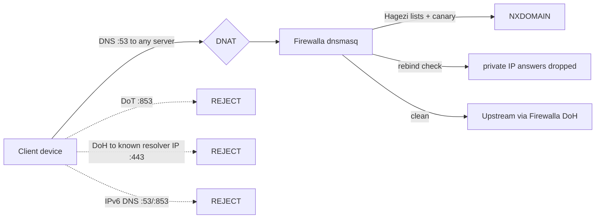

# firewalla-dns-hardening

Make DNS-based malware filtering on a Firewalla box hard to bypass.

Firewalla already filters DNS well, but out of the box a device can still sidestep it: by using its own DNS server, by switching to encrypted DNS (DoT/DoH), or simply because it is set to "no monitoring" or Emergency Access is on. This repo adds a few small, independent layers that close those gaps, plus a canary that tells you when the filtering silently stops working.

Everything is plain bash on the box, fully reversible with one command.

> **Unsupported modification.** This is not an official Firewalla feature. A firmware update can change paths or behaviour. Run `healthcheck.sh` after every update. Use at your own risk.

Tested on a **Firewalla Gold SE in bridge mode** (firmware 0.0818, Ubuntu 22.04). Router mode should work with `LAN_IF` set to your LAN bridge, but is untested.

## What it does

| # | Layer | What it stops | How |
|---|-------|---------------|-----|
| 1 | Threat blocklists | Malware, phishing, C2, scam and fake-shop domains | [Hagezi](https://github.com/hagezi/dns-blocklists) lists (TIF mini, DoH, fake) loaded into Firewalla's dnsmasq, refreshed daily with a download guard |
| 2 | Forced DNS | Devices hardcoded to 8.8.8.8 and friends | iptables DNAT of all client port-53 traffic to the Firewalla |
| 3 | DoT/DoQ block | Encrypted DNS on port 853 | REJECT tcp/udp 853, so clients fall back to plain DNS (which is then redirected) |
| 4 | DoH block by IP | Apps or malware talking DoH straight to an IP (e.g. `1.1.1.1:443`) | ~1,400 known DoH resolver IPs in an ipset, tcp/udp 443 rejected. The box's own DoH keeps working |
| 5 | DNS rebinding protection | Websites using your browser to reach your router, NAS or cameras | dnsmasq `stop-dns-rebind`: public names may not resolve to private IPs |
| 6 | IPv6 DNS block | DNS/DoT over IPv6 bypassing the redirect | ip6tables REJECT on forwarded 53/853 |
| 7 | Outbound SMTP block (optional) | Infected devices sending spam directly | REJECT tcp/25 from clients |
| 8 | Canary + alerting | Filtering that silently stopped working | Every 10 min: blackholed sentinel domain, list size/age, DNAT present. Alerts via healthchecks.io after 3 failed runs, self-recovers |
| 9 | Boot hook | Unfiltered window after a reboot | Rules re-applied from `post_main.d` right after startup, plus a 5-minute cron safety net |



## Install

On the Firewalla, as user `pi` (SSH password is in the app: Settings > Advanced > Configurations > SSH Console):

```bash
git clone https://github.com/TrackPixel/firewalla-dns-hardening.git
cd firewalla-dns-hardening
bash install.sh
```

The installer copies the scripts, creates `fw-hardening.env`, backs up your cron file, adds the cron entries, downloads the lists, applies the rules and prints a health report. It is safe to run again.

Then, optionally:

1. Create a free check on [healthchecks.io](https://healthchecks.io) (period 1 hour, grace 20 minutes) and put its ping URL in `/home/pi/.firewalla/config/fw-hardening.env` as `HC_URL`.
2. Set `CONTROL_DOMAIN` to a domain you care about.

Prefer to do it by hand, or only want some layers? See [docs/manual-install.md](docs/manual-install.md).

## Verify

```bash
/home/pi/.firewalla/config/fw-hardening/healthcheck.sh
```

Every line should start with `[OK]`. Client-side tests (from a PC on your network) are in [docs/testing.md](docs/testing.md).

## Undo

```bash
bash uninstall.sh            # remove everything, keep your settings
bash uninstall.sh --purge    # also remove fw-hardening.env and the allow-list
```

Per-layer undo and a quick "pause" are in [docs/undo.md](docs/undo.md).

## Files on the box

| Path (under `/home/pi/.firewalla/config/`) | Purpose |
|---|---|
| `fw-hardening/*.sh` | The scripts |
| `fw-hardening.env` | Your settings (not overwritten on reinstall) |
| `dnsmasq_local/hagezi-*.conf` | Downloaded blocklists |
| `dnsmasq_local/fwh-rebind.conf` | Rebinding protection + your exceptions |
| `dnsmasq_local/fwh-canary.conf` | Canary sentinel |
| `doh-ips.txt`, `doh-ips-allow.txt` | DoH IP list and your exceptions |
| `post_main.d/fw-hardening-boot.sh` | Boot hook |
| `user_crontab` | Cron entries, tagged `# fw-hardening` |
| `dns_canary.log`, `dns_canary.state` | Canary history and failure streak |

## Cron schedule

| When | Job |
|---|---|
| 04:30 daily | `update_blocklist.sh` |
| 04:40 daily | `doh_ipblock.sh update` |
| every 5 min | `enforce_dns.sh`, `doh_ipblock.sh enforce` (Firewalla rebuilds iptables regularly) |
| every 10 min | `dns_canary.sh` |

## Documentation

- [How it works](docs/how-it-works.md): the reasoning behind each layer
- [Manual install](docs/manual-install.md): step by step, layer by layer
- [Testing](docs/testing.md): what to run before and after, and what to expect
- [Troubleshooting](docs/troubleshooting.md): VPNs, Plex, SSH after reboot, allow-lists
- [Undo](docs/undo.md): full and per-layer rollback

## Feature request to Firewalla

Most of this would be better as native toggles in the app: enforce DNS for unmonitored devices too, block DoH/DoT bypass (by name and IP), DNS rebinding protection with an exception list, custom blocklist URLs with auto-refresh, and a health indicator for DNS filtering. If that happens, this repo can retire.

## Credits

- Blocklists by [HaGeZi](https://github.com/hagezi/dns-blocklists) (GPL-3.0). This repo only downloads them; please support the project.
- Test domains: [nip.io](https://nip.io), [localtest.me](https://readme.localtest.me).

## License

MIT, see [LICENSE](LICENSE).
